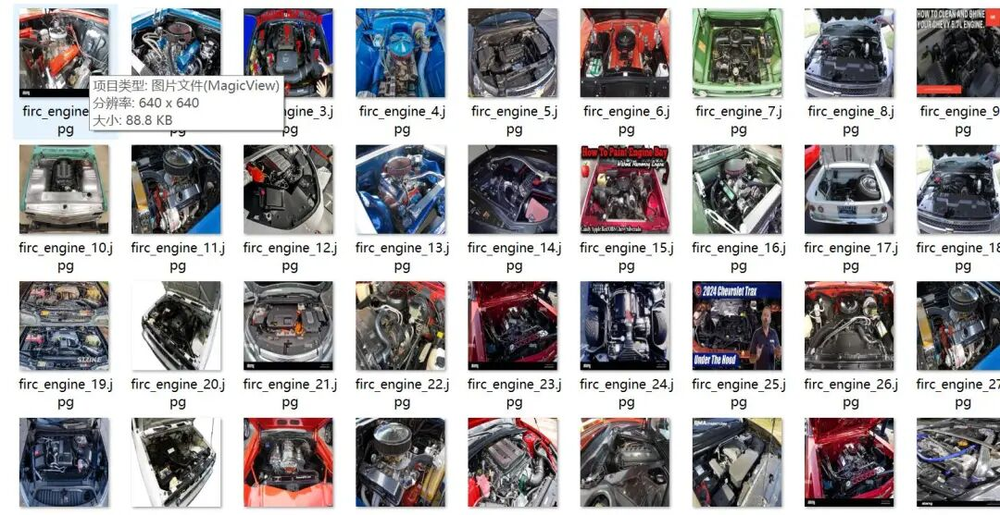
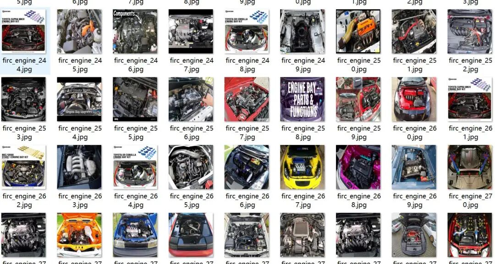
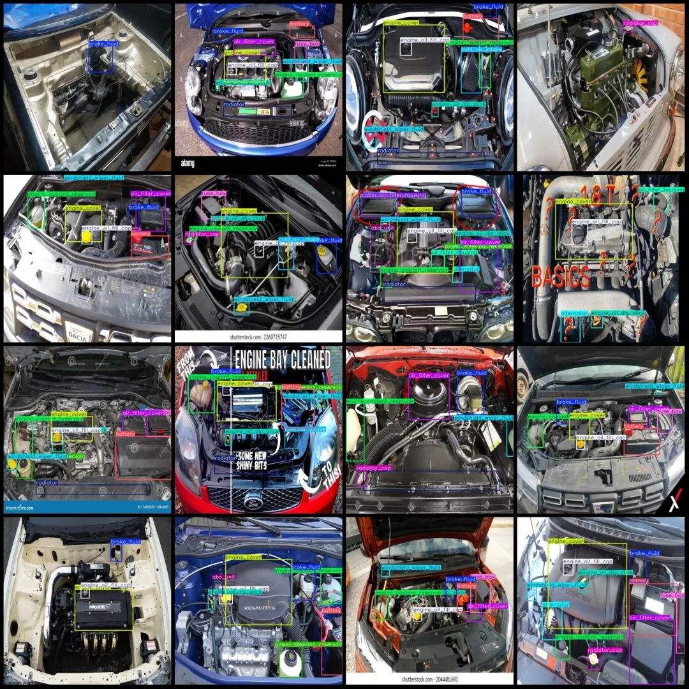
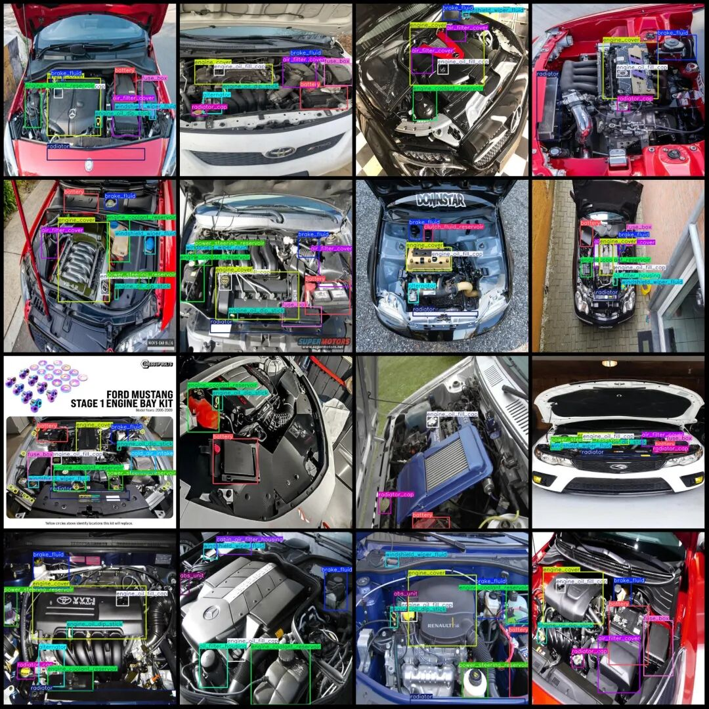

# Vehicle Engine Cabinet Parts Front Car Cover Engine Area Equipment Inspection Data Set VOC+YOLO format with 622 images and 25 categories

Dataset format: Pascal VOC format + YOLO format (txt file without split path, only contains jpg images and corresponding VOC format xml files and yolo format txt files)

Number of images (number of jpg files): 622

Number of annotations (number of xml files): 622

Number of annotations (number of txt files): 622

Label category count: 25

Label category name(NoteyoloThe formatting category does not correspond to this, but instead...labelsFolderclasses.txtPrecision):["abs_unit","air_filter","air_filter_cover","alternator","battery","brake_fluid","cabin_air_filter_housing","clutch_fluid_reservoir","cold_air_intake","electric_motor","engine_coolant_reservoir","engine_cover","engine_oil_dip_stick","engine_oil_fill_cap","fuse_box","intercooler_coolant_reservoir","inverter_coolant_reservoir","oil_filter","oil_filter_housing","power_steering_reservoir","radiator","radiator_cap","secondary_coolant_reservoir","transmission_oil_dip_stick","windshield_wiper_fluid"]

Number of boxes labeled in each category:

abs_unit (ABS unit) frame count = 108

Air Filter (Air Cleaner) Frame Count = 28

Air Filter Cover (Air Filter Cover) Frame Count = 383

Alternator (AC generator) Frame Count = 135

Battery (battery pack) Frame Count = 398

brake_fluid (Brake Fluid) Frame Count = 512

cabin_air_filter_housing (air filter housing for cabin air conditioning) Frame count = 13

clutch_fluid_reservoir (Clutch Fluid Reservoir) Frames = 44

cold_air_intake (Air intake (cold air) frame count = 92

electric_motor (Motor) Frame Count = 13

engine_coolant_reservoir (engine coolant reservoir) Frame count = 463

engine_cover (engine cover) frame count = 467

engine_oil_dip_stick (engine oil dip stick) frame count = 377

Engine Oil Filler Cap (engine oil fill cap) Frame Count = 511

fuse_box (fuse box) Frame count = 295

intercooler_coolant_reservoir (Coolant liquid storage tank (cooler) - number of frames = 7

inverter_coolant_reservoir (Inverter cooling fluid storage tank) Frame count = 10

Oil Filter (Oil Filter) Frame Count = 5

Oil Filter Housing (Spark Plug Oil Filter Housing) Frame Count = 48

Power Steering Reservoir (Power Steering Oil Tank) Frame Count = 213

Radiator (radiator) Frame Count = 340

Radiator cap (radiator cover) frame count = 248

Secondary Coolant Reservoir (Auxiliary Coolant Reservoir) Frame Count = 6

transmission_oil_dip_stick (gearbox oil dip stick) frame count = 36

windshield_wiper_fluid (Windshield washer fluid) Frame count = 417

Total frame count: 5169

Number of images per category:

abs_unit (ABS unit) occupies picture count = 107

Air Filter (air filter) occupies a picture count = 28

Air Filter Cover (Air Filter Cover) occupies a picture count = 345

Alternator (AC generator) occupies 132 images.

Battery (battery) occupies the image count = 389

brake_fluid (Brake Fluid) occupies the image count = 503

cabin_air_filter_housing (air filter housing for cabin air conditioning) occupies = 13

clutch_fluid_reservoir (Clutch Fluid Reservoir) occupies = 44

cold_air_intake (cold air intake) occupies = 85

electric_motor (Motor) occupies 13% of the image

engine_coolant_reservoir (engine cooling fluid reservoir) occupies = 452

engine_cover (engine cover) occupies a picture count = 458

engine_oil_dip_stick (engine oil dip stick) occupies a picture count = 366

engine_oil_fill_cap (engine oil fill cap) occupies = 500

fuse_box (fuse box) occupies = 275

Intercooler_coolant_reservoir (Intercooler Coolant Reservoir) occupies = 7

Inverter_coolant_reservoir (Inverter Coolant Reservoir) occupies = 10

oil_filter (oil filter) occupies a picture count = 5

Oil Filter Housing (Sludge Pump Housing) - Occupies 48 images.

power_steering_reservoir (Power Steering Reservoir) occupies = 209

Radiator (heater) occupies a picture count = 334

Radiator cap (radiator cover) occupies = 243

Secondary Coolant Reservoir (Auxiliary Coolant Reservoir) occupies = 6

transmission_oil_dip_stick (Transmission Oil Dip Stick) occupies = 31

Windshield Wiper Fluid (Windshield Washer Fluid) occupies 406 images.

Image resolution: 640x640

Using labelImg:

Annotation rules: Draw a rectangle around the category.

Important Notice: The dataset does not have separate training, validation, and test sets; you need to partition them yourself.

Special : This dataset does not guarantee the accuracy of the trained models or weight files.

Image Preview:

Annotation example:

## Payment

Here is a pay link on Stripe ( https://buy.stripe.com/3cs8yP7sY87d0vu9AB ). Please contact me lonlonago@foxmail.com after funding $89, and I will send you a complete data files , thank you!

